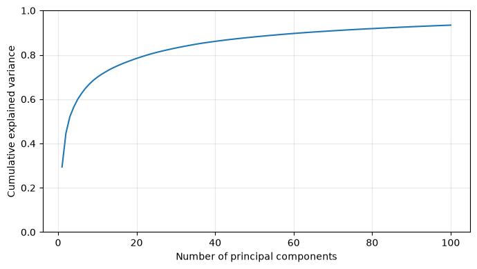
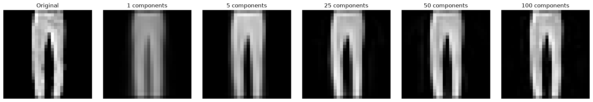
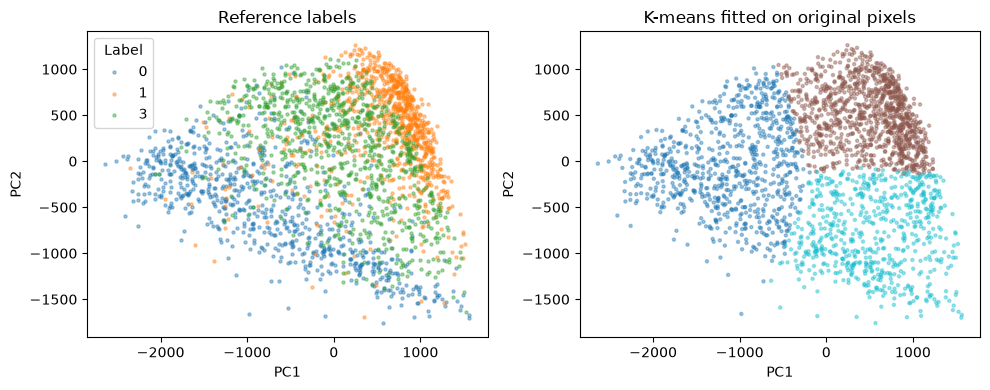

# PCA and K-means from Scratch

Educational NumPy implementations of PCA and Lloyd K-means, adapted from
undergraduate data-analysis coursework at Paris-Dauphine–PSL.

## Overview

This project studies dimensionality reduction, image reconstruction and clustering
on 28 × 28 clothing images. It preserves the scope of the original coursework
while organizing the code into reusable classes and one analysis notebook.

**Validation:** The notebook includes saved outputs from a complete run using Python 3.14.7.

## Objective

Understand PCA through covariance eigendecomposition and investigate how reducing
the feature space affects K-means clustering and image reconstruction.

## Methods / Algorithms

- PCA: centering, optional scaling, covariance matrix, symmetric eigendecomposition,
  projection and inverse reconstruction.
- K-means: random initialization, nearest-centroid assignment, mean updates,
  empty-cluster reinitialization and convergence tolerance.
- Evaluation: cumulative explained variance and cluster purity.

Both algorithms are implemented with NumPy rather than scikit-learn. The notebook
uses three clusters, a fixed seed and a small set of PCA dimensions.

## Technologies

Python, NumPy, pandas, Matplotlib and JupyterLab. Dependency versions are not pinned; the notebook does not record installed
package versions.

## Repository Structure

| Path | Purpose |
| --- | --- |
| `pca.py` | PCA class |
| `kmeans.py` | Lloyd K-means class |
| `analysis.ipynb` | Data checks, experiments and plots |
| `data/README.md` | Expected files and provenance limitation |
| `results/` | Generated plots and metrics |
| `requirements.txt` | Python dependencies |

## Dataset

The coursework reads `pixels.csv` and the `label` column of `labels.csv`.
The executed notebook contains **2,535 images × 784 pixels**, with pixel values
from 0 to 255. Numeric labels 0, 1 and 3 have 785, 863 and 887 images. Input
checks completed successfully. Class names are not inferred without source confirmation.

The exact original source, subset and redistribution terms are not confirmed.
The CSV files are included in the data directory.
They must retain their original row alignment. See [data instructions](data/README.md).

## How to Run

Run these commands from the repository root on macOS or Linux:

```bash
python3 -m venv .venv
source .venv/bin/activate
python -m pip install -r requirements.txt
python -m jupyterlab
```

The required CSV files are available at `data/pixels.csv` and `data/labels.csv`. Open `analysis.ipynb`, select the environment kernel and run
all cells in order. Run JupyterLab from the repository root so imports and relative
paths resolve. The supplied notebook records a complete successful run; environment installation
steps were not independently reproduced by the reviewer.

## Results

Settings: centered pixels without standardization, 3 clusters, seed 42,
one random initialization per representation, maximum 100 iterations.

| Representation | Dimensions | Cluster purity | Iterations | Converged |
| --- | ---: | ---: | ---: | --- |
| Original pixels | 784 | 56.88% | 35 | Yes |
| PCA | 2 | 56.77% | 28 | Yes |
| PCA | 25 | 56.92% | 35 | Yes |
| PCA | 50 | 56.88% | 34 | Yes |

PCA with 25 or 50 components preserves almost the same purity as the original
784-dimensional representation in this run. The 25-component score is only
0.04 percentage points higher; no robust improvement is claimed. The experiment
does not measure runtime or evaluate generalization.



The variance curve indicates approximately 93% retained variance at 100
components (read visually from the saved plot).



The displayed example retains more detail as additional components are used.
This is an illustrative reconstruction, not an aggregate error benchmark.



Reference categories overlap in the 2D projection. K-means captures some broad
regions but does not cleanly recover the categories. On the right, clusters were
fitted on all original pixels and then visualized in the same PCA coordinates.
Colors are not matched between reference labels and cluster identifiers.

Exact scores are available in [metrics.csv](results/metrics.csv); outputs are
also embedded in [the executed notebook](analysis.ipynb).

## Evaluation and Limitations

Purity sums the majority-class count in each cluster and divides by the total
sample count. It is not classification accuracy and can increase when more
clusters are used. Labels are used only for evaluation and visualization.

This is exploratory unsupervised coursework. There is no held-out prediction
benchmark, deployment or production claim. Each setting uses one initialization;
differences may depend on local minima. Exact data provenance remains unresolved.

## What I Learned

- How PCA connects covariance eigenvectors to projection and reconstruction.
- How initialization and feature representation affect K-means.
- Why integer arithmetic, component ordering and metric definitions matter.

## Academic Context and Contributions

Derived from submitted TP2 and TP3 notebooks and their teaching scaffold.
The original TP3 explicitly supplies K-means and an evaluation helper from the
previous session; supplied scaffolding is not claimed as independently authored.
The exact division between student-written code and supplied helpers is not
documented here; the project is presented as coursework adapted from this scaffold.

Post-coursework cleanup was prepared with AI assistance: consolidating classes,
float pixel arithmetic, descending component order, explicit purity terminology,
fixed seeds, final-label reassignment and bounded-memory distance batches.
The algorithmic scope remains PCA and K-means.
